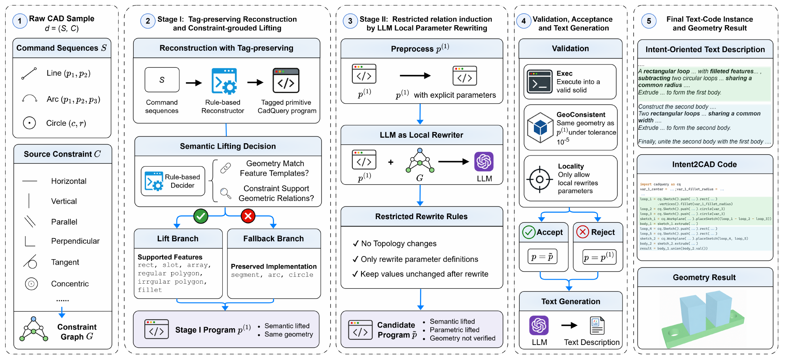

# Intent2CAD: How Semantic–Parametric Supervision Shapes Text-to-CAD Generation

Official implementation of our NeurIPS 2026 paper. Intent2CAD studies how CAD program representations affect text-to-CAD generation and intent-preserving editing.

[Dataset](https://huggingface.co/datasets/scottyjb/Intent2CAD) · [Installation](#installation) · [Data Preparation](#data-preparation) · [Training](#training) · [Evaluation](#evaluation)

## Overview

Intent2CAD constructs three aligned representations of the same CAD model: **primitive**, **semantic**, and **semantic–parametric** programs. The construction pipeline has two stages:

- **Semantic lifting:** recover high-level features from primitive geometry and source constraints.
- **Parametric lifting:** recover shared parameters and derived relations through local LLM-proposed rewrites, followed by execution and geometry checks.



*Figure 3 from the paper: constraint-grounded lifting, parameter rewriting, validation, and text generation.*

## Installation

Python 3.12 and CadQuery 2.7.0.

```bash
conda create -n intent2cad python=3.12
conda activate intent2cad
pip install -r requirements.txt
```

## Dataset

The [Intent2CAD dataset](https://huggingface.co/datasets/scottyjb/Intent2CAD) provides aligned programs for text-to-CAD generation and intent-preserving editing:

| Configuration | Splits | Contents |
| --- | --- | --- |
| `generation` | train / validation / test | Text descriptions and three program representations |
| `editing` | test | Source programs, edit instructions, target programs, and evaluation annotations |

Editing covers Feature Edit (FE), Consistency Edit (CE), and Derived-Relation Edit (DE).

```bash
python scripts/prepare_data.py
```

## Data Preparation

```bash
cp .env.example .env
```

Set these values in `.env`:

| Variable | Value |
| --- | --- |
| `OPENAI_API_KEY` | Your API key |
| `CAD_JSON_ROOT` | DeepCAD construction records in JSON format, containing sketch geometry and modeling operations, stored as `<group>/<id>.json` |
| `CONSTRAINT_ROOT` | Sketch constraints collected through the Onshape API, stored as `<id>_*_featurescript_*.yml` or `<id>.json`. Subdirectories are searched recursively. |

```bash
python scripts/synthesize.py
```

The pipeline reconstructs programs, performs both lifting stages, generates descriptions, and builds editing triples. Outputs are written to a new `data/synthesized/` directory. Raw CAD records and constraint exports must be provided separately.

## Training

Primitive representation:

```bash
torchrun --nproc_per_node=2 training/train.py primitive
```

Semantic representation:

```bash
torchrun --nproc_per_node=2 training/train.py semantic
```

Semantic–parametric representation:

```bash
torchrun --nproc_per_node=2 training/train.py semparam
```

## Evaluation

Save predictions as `<prediction_directory>/<representation>/<group>/<id>.py`, where representation is `primitive`, `semantic`, or `semparam`.

```bash
python evaluation/evaluate.py generation predictions/generation results/generation
python evaluation/evaluate.py editing predictions/editing results/editing
python evaluation/analyze.py results/editing/per_sample.jsonl results/editing/analysis.json
```

Generation evaluation reports IR, CD, AR, ERS, and PRS. Editing evaluation reports edit success and unchanged-loop preservation, with CD as a geometric comparison. Each run writes per-sample results and a summary. Use `--representation semparam` to evaluate one representation; output directories must be new.

## Citation

```bibtex
@inproceedings{yang2026intent2cad,
  title     = {{Intent2CAD}: How Semantic--Parametric Supervision Shapes Text-to-CAD Generation},
  author    = {Jinbo Yang and Mingyue Yuan and Shikai Jing},
  booktitle = {Advances in Neural Information Processing Systems},
  year      = {2026}
}
```

## Acknowledgements

CAD construction sequences are derived from [DeepCAD](https://github.com/rundiwu/DeepCAD). Programs use [CadQuery](https://github.com/CadQuery/cadquery).

## License

Code and data are released under [CC BY-NC 4.0](https://creativecommons.org/licenses/by-nc/4.0/). Third-party materials retain their original licenses.
